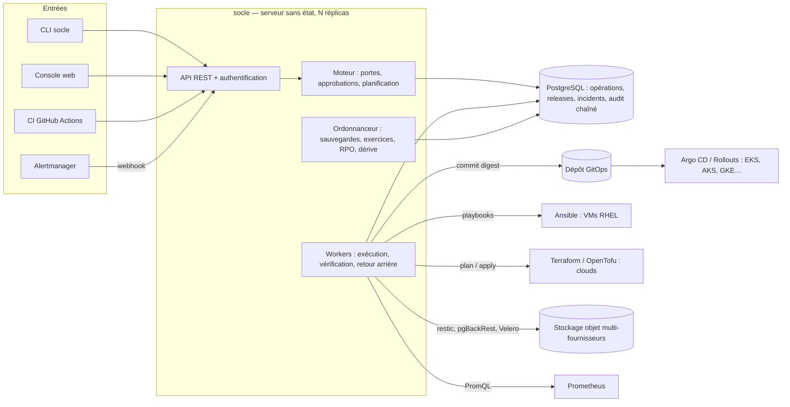
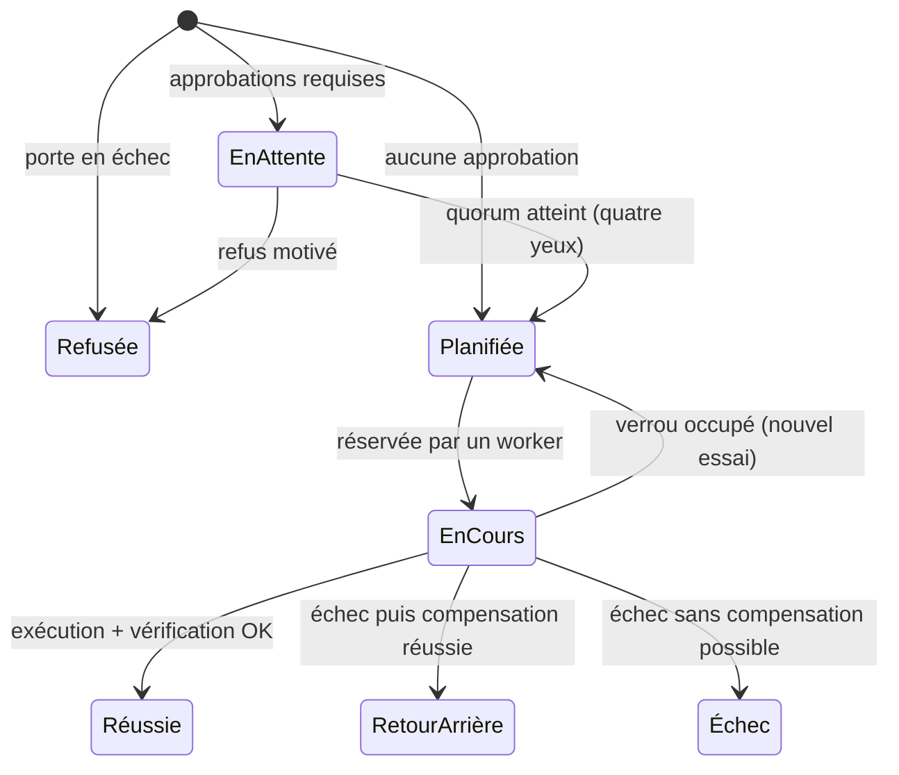

# socle — architecture

**socle** est le plan de contrôle du cycle de vie des déploiements applicatifs et
des infrastructures du lab : déploiement, CI/CD, supervision, scalabilité,
environnements, sauvegardes et restaurations, sécurité, incidents et maintenance.
Il couvre le multi-cloud (AWS, Azure, GCP, OVHcloud, Scaleway) et l'on-premise
(RHEL), Kubernetes comme VMs, à l'échelle d'une ETI (plusieurs équipes, haute
disponibilité).

## Choix structurants

| Sujet | Décision | Raison |
|---|---|---|
| Langage | Rust (workspace `socle/`) | Binaire unique, sûreté mémoire, performances ; noyau métier testable sans E/S |
| Interfaces | CLI + API REST + console web | Une seule logique métier, trois portes d'entrée ; la console n'utilise que l'API publique |
| Modèle | `socle.yaml` déclaratif, versionné, validé (références croisées) | Source de vérité unique, revue en merge request, empreinte enregistrée sur chaque opération |
| Kubernetes | GitOps Argo CD (+ Argo Rollouts pour canary/blue-green) | socle écrit le dépôt (digest immuable), Argo CD converge, socle vérifie |
| VMs RHEL | Ansible (Podman/Quadlet), par lots | Outillage existant du lab, sans agent supplémentaire |
| Infrastructure | Terraform/OpenTofu, plan puis application du plan approuvé | Ce qui est appliqué est exactement ce qui a été approuvé |
| Persistance | SQLite (instance unique) ou PostgreSQL (haute disponibilité) | Même code SQL portable ; HA par réplicas sans état |
| Secrets | Références uniquement (`env:`, `file:`, `vault:`, `aws-sm:`, `azure-kv:`, `gcp-sm:`) | socle ne stocke aucun secret ; valeurs masquées dans tous les journaux |
| Identité | OIDC (Entra ID, Keycloak, Okta, Google) + jetons d'API hachés | Groupes du fournisseur d'identité → équipes → rôles |

## Vue d'ensemble

Le cœur (`crates/socle-core`) est **pur** : il ne fait aucune entrée/sortie. Il
décrit le modèle, évalue les politiques et produit des plans déterministes.
Le crate `crates/socle` fournit les adaptateurs (stockage, exécuteur,
notifications, authentification) et les trois interfaces.

## Un seul circuit pour tous les changements

Déploiement, promotion, retour arrière, mise à l'échelle, plan et application
d'infrastructure, sauvegarde, restauration, exercice, correctifs et runbooks
sont tous des **opérations** qui suivent le même circuit :

1. **Planification** : la requête est résolue (release, release en place,
   instantané, plan d'infrastructure approuvé) puis transformée en plan :
   étapes, vérifications, compensation, verrous. Le plan est **haché**.
2. **Portes** : sécurité (tests, vulnérabilités, signature, SBOM, secrets —
   jamais contournables) et processus (ticket, fenêtre, gel, incident en cours,
   maintenance, promotion — contournables par la procédure d'urgence, tracée).
3. **Approbations** : nombre fixé par la politique de l'environnement ; le
   demandeur ne peut jamais approuver sa propre opération ; une approbation
   porte sur l'empreinte exacte du plan.
4. **Exécution** : un worker réserve l'opération (bail renouvelé), revérifie
   l'intégrité du plan et les portes sensibles au temps, prend les verrous
   puis joue les étapes.
5. **Vérification** : sonde HTTP et indicateur SLO (PromQL) après le changement.
6. **Compensation** : en cas d'échec, retour arrière automatique vers l'état
   connu et sain ; en production, ouverture d'un incident lié.

## Redondances éliminées

| Avant | Après |
|---|---|
| EC2 RHEL + ECS + EKS créés pour la même application | EKS (Kubernetes) + EC2 RHEL ; ECS supprimé |
| RDS PostgreSQL **et** Aurora | Aurora PostgreSQL seul (PITR, multi-AZ) |
| Manifests bruts + chart Helm + Kustomize (3 noms) | Kustomize base/overlays GitOps, HPA intégré à la base |
| GitHub Actions + GitLab CI identiques | GitHub Actions, logique métier dans socle |
| `backup_rotate.sh`, `managed_backup.sh`, scripts deploy/rollback/health-check de Shinra | Politiques de sauvegarde socle (restic, pgBackRest, Velero) avec RPO/RTO et exercices |
| `hardening.yml` + `cis_benchmark.yml` + `cis_audit.sh` | Playbooks Ansible ; l'audit = mode contrôle (runbook `audit-cis-rhel`) |
| Kyverno + Gatekeeper (mêmes règles) | Kyverno seul (règles Gatekeeper portées) |
| ESO + Vault Agent Injector | External Secrets Operator, backend AWS Secrets Manager ou Vault |
| Deux `prometheus.yml`, Logstash, Envoy inutilisés | Une configuration de supervision (`observability/`) |
| `sed` du tag d'image en CI | Release immuable (digest) enregistrée avec ses preuves, déployée par socle |
| `null_resource` « notes » dans Terraform | Documentation (`docs/aws/architecture-notes.md`) |
| État Terraform local | Backend S3 chiffré et verrouillé par environnement |

## Sécurité (DevSecOps)

- **Chaîne d'approvisionnement** : une release est un digest immuable
  accompagné de preuves (tests, rapport Trivy, signature cosign vérifiée,
  SBOM CycloneDX attesté, provenance CI). Les portes de sécurité ne se
  contournent pas, même en urgence. On promeut le même digest de dev à prod.
- **Moindre privilège** : rôles `viewer`, `auditor`, `operator`, `deployer`,
  `approver`, `admin`, portés par des équipes et restreints par environnement
  et par service ; liaisons versionnées dans `socle.yaml`.
- **Exécution** : aucune commande ne passe par un shell ; liste blanche de
  programmes ; environnement filtré (les variables `SOCLE_*` ne sont jamais
  transmises) ; délais ; chemins confinés au dépôt ; secrets résolus au dernier
  moment et masqués dans les journaux.
- **API** : CSP stricte, `X-Frame-Options: DENY`, pas de détail d'erreur
  interne renvoyé au client (référence corrélée dans les journaux), limite de
  taille de requête, délais.
- **Traçabilité** : journal d'audit chaîné (SHA-256), écrit dans la même
  transaction que chaque changement d'état ; vérifiable et exportable.

## Haute disponibilité

- Réplicas sans état derrière un Service Kubernetes ; état dans PostgreSQL.
- Réservation des opérations par `UPDATE … RETURNING` avec `FOR UPDATE SKIP
  LOCKED` : une opération n'est exécutée que par un seul worker.
- Bail renouvelé pendant l'exécution ; à expiration (perte d'un réplica),
  l'opération est marquée en échec, jamais rejouée silencieusement.
- Verrous à durée limitée (par service, cible, stack, politique) : pas de
  changements concurrents sur la même ressource.
- Ordonnanceur actif sur un seul réplica (verrou `scheduler`).
- Chaînage de l'audit sérialisé par verrou consultatif PostgreSQL.

## Conformité (ISO 27001 / SOC 2, benchmarks CIS)

`socle compliance --markdown` produit un dossier de preuves :

| Contrôle | Preuve produite par socle |
|---|---|
| A.8.32 / CC8.1 — gestion des changements | approbations par opération, quatre yeux, changements d'urgence listés |
| A.8.15 / CC7.2 — journalisation | intégrité de la chaîne d'audit vérifiée |
| A.8.13 / A1.2 — sauvegarde | RPO tenu, exercices à jour et dans le RTO |
| A.5.24–A.5.27 / CC7.4 — incidents | délais d'acquittement et de résolution, postmortems Sev1/Sev2 |
| A.5.15, A.5.18 / CC6.1–6.3 — accès | revue des équipes, rôles et jetons (expiration) |
| A.8.9, A.8.8 / CC7.1 — configuration et vulnérabilités | spécification versionnée, refus par les portes |

## Limites connues et suites

- Les zones d'accueil Azure, GCP, OVHcloud et Scaleway sont en place ; leur
  analyse Checkov reste non bloquante jusqu'au traitement des premiers écarts.
- L'exercice Aurora contrôle la connectivité du clone, pas encore une requête
  applicative.
- L'agent eBPF Shinra (privilèges noyau) reste à empaqueter en service système.
- Agents d'exécution déportés (sites sans accès entrant) : non nécessaires à
  l'échelle ETI, prévus si le besoin apparaît.
